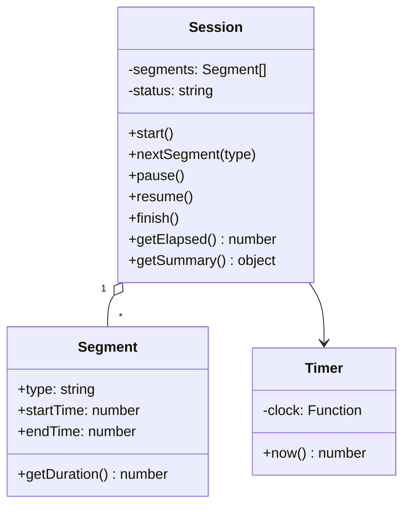

<div align="center">
    

# Sikad | Triathlon App

_Swim. Bike. Run. One clock, every leg._

`Sikad` is a triathlon tracker in the spirit of Strava, built around the thing multisport athletes actually do: switch disciplines mid-session. Instead of recording one activity at a time, you start a session, hit Next Segment when you move from one leg to the next (for example run → bike → swim), and get a timed breakdown of the whole workout.

> The name comes from the Filipino word sikad, meaning to pedal.

</center>

## Tech Stack


~✦~

</div>

## Branch Notes: `dev`

**Purpose**: Primary integration branch for active development. Features, fixes, and refactors are merged here before being promoted to production.

**Workflow**: `feature/* → dev → main`

**Notes**

- Keep builds passing.
- Merge tested work only.
- Sync regularly with main.

### Project Status

| Iteration | Stack | Scope |
|-----------|-------|-------|
| **1 (current)** | Vanilla JavaScript (ES2022), Jest | Core logic only: a segmented timer, no UI |
| 2 (planned) | React + Vite + TypeScript | UI built on top of the core logic |
| 3 (planned) | Geolocation | Distance, pace and route per segment |

This first iteration deliberately has **no user interface, no hardware APIs and no geolocation**. The goal is a well-designed, well-tested core that a front end can use later.

### Features (Iteration 1)

- **Start a session** and begin timing immediately.
- **Segments** for each leg (`run`, `bike`, `swim`, plus optional `transition`), recorded in any order, so it supports duathlon or other multisport formats as well as the standard triathlon.
- **Cut to the next segment** with one call; the previous segment closes and the next one opens with no gap.
- **Pause and resume** the session without losing elapsed time.
- **Finish** the session and get a summary: time per segment, total time and each segment's share of the total.
- **Input validation** with clear errors (invalid segment types, starting twice, finishing a session that never started, and so on).
- **Injectable clock** so every time-based behaviour is deterministic in tests.

### Planned (later iterations)
 
- GPS tracking: distance, pace, speed and route map per segment
- Saved session history and personal bests per discipline
- Transition (T1/T2) analysis
- Goal times and race-day pacing targets

## Design

Core classes (full UML diagrams live in `/docs`):



**Principles**

- Small classes with a single responsibility.
- ES modules, `const`/`let`, classes with private fields (`#field`), and other ES2022 features where they genuinely help.
- Time is accessed through an injected clock function, never by calling `Date.now()` directly inside business logic.
- No global state; everything is testable in isolation.

## Launching the app locally

### Requirements

- **Operating System:**

  - (a) Windows 10 or Windows 11 environment  
    &nbsp;&nbsp;&nbsp;&nbsp;- WSL1 installed to launch Linux Ubuntu environment  
    &nbsp;&nbsp;&nbsp;&nbsp;- Ubuntu LTS 22.04 distro installed
  - (b) Linux Ubuntu (**preferred**)

- **Software:**
  - Visual Studio Code installed
  - Node.js, npm, and Git installed

### Main Steps

1. Cloning the repository:

```bash
git clone https://github.com/arzen1kos/triathlon-app.git

cd triathlon-app
```

2. Installing the package for dependencies

In the parent directory, run the following commands:

```bash
rm -rf node_modules
rm -rf package-lock.json
npm install
```

3. Launching the app

In the parent directory, run the following commands:

```bash
npm run dev
```

---

Created by Arsenie — 2024
